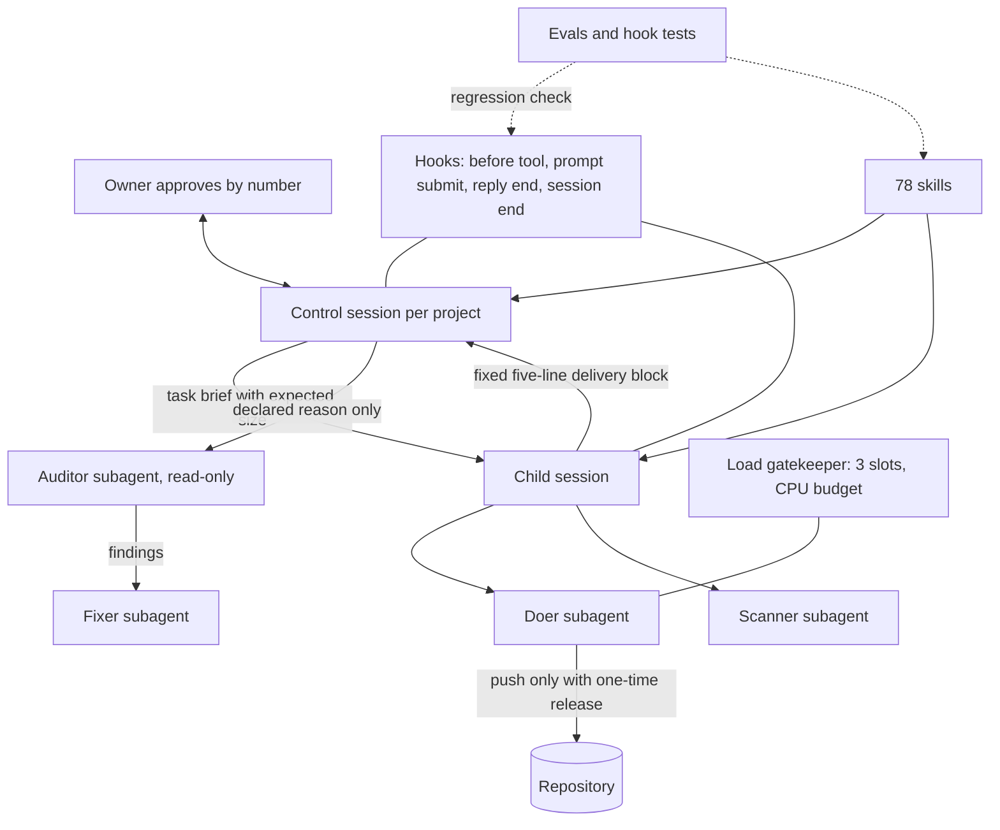

# Agent Ops Kit: Case Study

> A guardrail and orchestration layer for running many AI coding agents in parallel: a coordinator session per project, role-specific subagents, hooks that block what breaks the rules, a load gatekeeper, evals, and a token budget measured from real transcripts.
> **Source code is private.** This repository documents the project; a live walkthrough is available on request.

**Stack:** Claude Code plugins (skills, subagents, commands, hooks), Bash and Python hook scripts with their own test suite, LLM-as-judge evals, launchd watchdogs on macOS, PostgreSQL for usage data.

**Status:** personal infrastructure in daily use since September 5, 2026. Not a product: it evolves with each incident it prevents, and the numbers below are from November 17, 2026.

## The problem

Running several projects with AI coding agents fails in predictable ways. An agent pushes without being asked. Two sessions edit the same files. A long conversation silently loses its state. A test run with no worker limit takes the whole machine to 100% CPU. And every new conversation starts expensive: before the first word, the model has already read 117,800 to 138,000 tokens of rules, skill listings, and tool definitions.

Each failure is small. Together they make parallel agents unusable, and instructions in a prompt do not fix them, because a prompt is advice and the agent can ignore it under pressure.

## What the kit does

- **Coordinator pattern.** One long-lived "Control" session per project plans, writes task briefs, starts child sessions, reviews each delivery, and asks the owner for approvals. It does not implement beyond trivial changes and never deploys.
- **Task briefs with a fixed shape.** Every child session starts from a brief with the same blocks in the same order, including an expected size. A session that is about to pass twice that size stops and reports back instead of delivering.
- **Role-specific subagents.** 4 definitions: a scanner (read-only fact finding), a doer (builds inside the scope), an auditor (read-only, fresh context, gives a verdict), and a fixer (applies only what the auditor pointed out). The auditor runs only with a declared reason such as security, auth, payments, or migrations.
- **78 skills** (68 in the project kit plus 10 global, about 7,300 lines): deploy runbooks that refuse to run without the project's deploy document, QA, legacy audit, session handoff, and a prompt library. Every skill carries "criterion zero": missing input means ask, never invent.
- **Hooks as guardrails.** 19 shell scripts (23 script files with the Python helpers, about 5,100 lines) registered 18 times on 5 lifecycle events. Details below.
- **Load gatekeeper.** Tests, builds, and video encoding run only through a queue, with a CPU budget per job.
- **Evals.** 5 suites with rubric graders and repeated runs, covering skill behavior such as "ask a clarifying question before building".
- **Token accounting.** A measurement of where the fixed context goes, used to decide what to cut.

## Architecture

## Technical decisions and trade-offs

**Deterministic hooks over prompt instructions.** Rules that matter are code, not prose. A hook receives the tool call as JSON and can refuse it with a message that includes the corrected command. Examples: destructive git operations, pushes without a release token that is valid for one commit and consumed on use, test or build commands outside the gatekeeper, session titles outside a naming pattern, visible browser windows for automation. A reply hook checks that every answer ends with a fixed footer (status, numbered pending decisions in a fixed verb order, what is running, sources) and returns the reply to be rewritten if it does not.
*Trade-off:* hooks add latency and a maintenance surface, and a wrong hook blocks real work. To contain that, each new rule starts as a warning with a date after which it blocks, and every hook has a test file. A rule change becomes a code change with a test.

**Load gatekeeper instead of "be careful".** On a Mac with 18 logical cores, one test run with no worker limit opened 17 workers and pushed load to 18.6, which is 100%. The fix is a wrapper that queues jobs in 3 slots, lowers their priority, and gives each one a CPU budget computed from what is already running so the whole machine stays near 60%. A separate watchdog stops the heaviest agent process tree if CPU or memory crosses a hard limit.
*Trade-off:* jobs wait in line, and the budget is decided only when a job starts (the OS cannot cap a running process), so the watchdog remains as a safety net.

**Context handoff by measured threshold.** Long coordinator sessions lose state when the context window fills and the app compacts it silently. I measured 35 real handoffs and simulated candidate thresholds against them. The result: warn at 45% of the window ("finish the current block and hand off") and refuse replies at 60%. A wide gap between warning and block keeps the block from landing in the middle of a push chain. The outgoing session rewrites a handoff file, and the successor reads all of it before acting.
*Trade-off:* a fresh session re-reads its rules, so handoffs cost tokens. Fewer, later handoffs beat frequent early ones.

**Measure tokens before optimizing them.** From usage records of 12 sampled sessions, a new conversation costs 117,800 to 138,000 input tokens on its first call. The global rules file is 74,709 bytes (about 22,600 tokens by a 3.3 characters-per-token estimate) and loads in every conversation, including small child sessions that never coordinate anything. Only about 29% of it applies to every session. The skill listing adds about 9,000 tokens. Hooks per message are cheap (282 to 673 characters). Based on this, the rules file was split into a small core plus four skills loaded on demand: it went from 74,709 to 27,890 bytes (about 22,600 to 8,500 tokens), saving about 14,000 tokens in every conversation that does not need the coordinator rules. A script confirmed that all 54 moved paragraphs exist unchanged in the new files, and the 1,850 hook tests stayed green.
*Trade-off:* a coordinator that forgets to load its rules skill would misbehave, so the plan includes a hook that injects a reminder when the session is a coordinator.

**Subagent roles with different models.** The scanner and auditor run on a mid-size model; the builder and fixer run on the larger one at low effort. A study identified the fixer as a candidate for a cheaper model, since it only applies findings that already exist. That change waits for an eval to confirm it.

## Results

- 1,381 commits since September 5, 2026, one adjustment per commit, plus 62 written analysis and plan documents that record each decision with its measurement.
- 31 test files in the kit's test folder (about 6,700 lines of Bash), covering the hooks, the gatekeeper, watchdogs, and the sync script.
- The gatekeeper came from a measured incident (load 18.6 from one test run) and now caps every test, build, and encode at 3 slots.
- Handoff thresholds were chosen from 35 measured sessions, not from intuition.
- The token study found that two items, the rules file and the skill listing, account for most of the fixed cost the kit controls.

## Limits, stated honestly

- It is built for one operator on one machine. The hooks assume macOS and a specific app; this is infrastructure, not a portable framework.
- The eval suites exist but I have not yet run them to record a baseline, and they are not wired to CI. Hook tests are the stronger regression net today.
- Token numbers use an estimated conversion, not a tokenizer, with an expected error of about 15%. The "tokens saved" figures are projections until the cut ships and is measured.
- Skill usage data covers 7 days and only the skill-tool path. I would not remove skills without 90 days of data.
- Some skills are vendored from third parties and are not part of this case.

## What I'd do differently

- Put the token budget under test from day one. The rules file grew to 74 KB in about two months because nothing failed when it grew. A test that fails above a size limit would have stopped it.
- Write deterministic hook tests before the LLM evals. They run free on every commit and catch what breaks most.
- Start with the coordinator's rules as skills loaded on demand, not as one always-on file.
- Add a retrieval layer only after text search over the docs proves insufficient. The local database has full-text search but no vector extension, so the plan starts with keyword search.

## My role

I designed and built all of it: the coordinator pattern, the hooks and their tests, the load gatekeeper and watchdogs, the handoff thresholds and the measurements behind them, the evals, and the token study.

---
Built by **Victor Sestrem** · [LinkedIn](https://www.linkedin.com/in/victor-sestrem/) · victor-sestrem@hotmail.com
